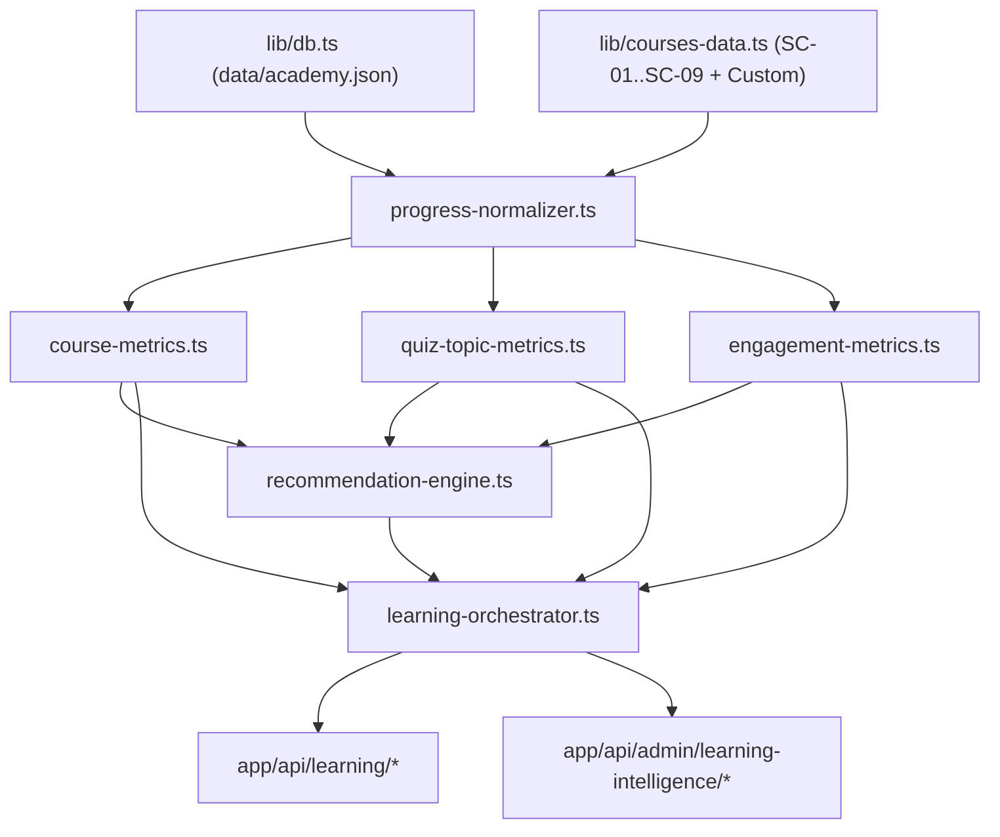

# SIGNAL CASPER ACADEMY — SPRINT 4 ARCHITECTURE
## Student Learning Intelligence & Adaptive Learning System

**Baseline Commit:** `e04cf4083eca4967c1bad0170fad60795bb02c63`  
**Parent Commit:** `8304711919d4915d86f95dd4dcbd8bedbe4e10cc`  
**Branch:** `main` (Clean working tree verified prior to Sprint 4)

---

## 1. Tujuan Arsitektur Sprint 4

Sprint 4 membangun lapisan **Student Learning Intelligence & Adaptive Learning** di atas fondasi kurikulum, progres belajar, evaluasi kuis, dan penyimpanan JSON (`data/academy.json`) yang sudah berjalan di Sprint 1–3. Sistem ini menyediakan:

1. **Student Learning Dashboard** — Ringkasan progres belajar, pelajaran terakhir untuk dilanjutkan (*Continue Learning*), rekomendasi adaptif berikutnya, progres per kursus, penguasaan topik kuis, dan kontinuitas belajar.
2. **Learning Progress Intelligence Engine** — Perhitungan deterministik untuk penyelesaian pelajaran/kursus, skor kuis, penguasaan topik (*Topic Mastery*), dan kematangan data (`NO_DATA`, `INSUFFICIENT_DATA`, `AVAILABLE`).
3. **Adaptive Learning Recommendation Engine** — Mesin rekomendasi berbasis aturan transparan dan dapat dijelaskan (*explainable*), mencakup `CONTINUE_LEARNING`, `NEXT_LESSON`, `RETRY_QUIZ`, `REVIEW_WEAK_TOPIC`, `START_FOUNDATION`, `ADVANCE_TO_NEXT_COURSE`, dan `RETURN_TO_LEARNING`.
4. **Admin Education Intelligence** — Analitik pendidikan agregat untuk Administrator (overview kohort, performa per kursus, *lesson/module drop-off*, *quiz & question intelligence*, filter rentang waktu `7d`/`30d`/`90d`/`all`, serta perlindungan kohort kecil $N < 3$).
5. **Engagement & Retention Analytics** — Pengukuran *Daily/Weekly/Monthly Active Learners*, *Course Funnel*, distribusi ketidakaktifan, dan retensi berbasis kohort aktivitas pertama.

---

## 2. Audit Siklus Hidup Belajar Eksisting (Baseline Trace)

| Tahap Siklus Hidup | Komponen / Rute Eksisting | Data yang Tersimpan Saat Ini | Celah untuk Sprint 4 & Solusi |
| :--- | :--- | :--- | :--- |
| **1. Registrasi & Login** | `POST /api/auth/register`, `POST /api/auth/login`, [`lib/server-auth.ts`](file:///d:/Developer/Web%20Casper%20Signal/lib/server-auth.ts) | `db.users` (`id`, `email`, `name`, `role`, `created_at`, `updated_at`) | Sudah lengkap. Akun siswa memiliki `role === "USER"`. |
| **2. Penemuan & Akses Kelas** | `GET /api/courses`, `/belajar`, `/belajar/[slug]`, `/kelas/[slug]` | Kurikulum 9 kelas inti (`SC-01` s/d `SC-09`, 18 modul, 54 pelajaran) + `db.custom_courses` | Hanya kelas berstatus `published` yang dihitung sebagai peluang belajar aktif siswa. |
| **3. Inisialisasi & Penyelesaian Materi** | `POST /api/progress` -> [`validateAndPersistUserProgress`](file:///d:/Developer/Web%20Casper%20Signal/lib/server-progress.ts#L39-L230) | `db.course_progress` (`completed_lesson_ids`, `quiz_scores`, `last_lesson_id`, `updated_at`) | `updated_at` tertimpa setiap update. **Solusi:** Rekam event minimal `COURSE_STARTED`, `LESSON_STARTED`, `LESSON_COMPLETED`, dan `COURSE_COMPLETED` secara idempoten di `db.learning_events` saat mutasi progres server. |
| **4. Pengumpulan Kuis** | `POST /api/quiz/submit` -> [`evaluateAndRecordServerQuiz`](file:///d:/Developer/Web%20Casper%20Signal/lib/server-progress.ts#L260-L455) | `db.quiz_submissions` (`course_slug`, `lesson_id`, `score`, `answers`, `created_at`) + update `db.course_progress` | `db.quiz_submissions` sudah menyimpan `answers` per `questionId` dan `created_at`. Tambahkan pencatatan `QUIZ_SUBMITTED` dan `COURSE_COMPLETED` (bila kuis menyelesaikan kelas) ke `db.learning_events`. |
| **5. Tampilan Dashboard Siswa & Admin** | [`app/dashboard/page.tsx`](file:///d:/Developer/Web%20Casper%20Signal/app/dashboard/page.tsx), [`app/admin/page.tsx`](file:///d:/Developer/Web%20Casper%20Signal/app/admin/page.tsx) | Menggunakan pembacaan dasar `/api/progress` dan `/api/admin/overview` | Diperluas dengan endpoint `/api/learning/*` dan `/api/admin/learning-intelligence/*` tanpa menduplikasi sumber kebenaran `course_progress` dan `quiz_submissions`. |

---

## 3. Batas Modul Baru (`lib/learning-intelligence/`)

Seluruh logika analitik pembelajaran ditempatkan secara modular di `lib/learning-intelligence/`:

1. [`lib/learning-intelligence/types.ts`](file:///d:/Developer/Web%20Casper%20Signal/lib/learning-intelligence/types.ts) — Kontrak tipe lengkap untuk Student Learning Intelligence, Adaptive Recommendations, Engagement/Retention, dan Admin Education Intelligence.
2. [`lib/learning-intelligence/progress-normalizer.ts`](file:///d:/Developer/Web%20Casper%20Signal/lib/learning-intelligence/progress-normalizer.ts) — Normalisasi kurikulum aktif (`published` vs `draft`/`archived`), pemetaan topik/modul kuis yang backward-compatible, serta penyatuan `course_progress`, `quiz_submissions`, dan `learning_events`.
3. [`lib/learning-intelligence/course-metrics.ts`](file:///d:/Developer/Web%20Casper%20Signal/lib/learning-intelligence/course-metrics.ts) — Perhitungan progres keseluruhan dan per-kursus menggunakan aturan otoritatif [`evaluateCourseCompletion`](file:///d:/Developer/Web%20Casper%20Signal/lib/progress.ts#L618-L688).
4. [`lib/learning-intelligence/quiz-topic-metrics.ts`](file:///d:/Developer/Web%20Casper%20Signal/lib/learning-intelligence/quiz-topic-metrics.ts) — Evaluasi penguasaan topik (*Topic Mastery*), tren peningkatan skor antar percobaan, serta analitik tingkat kesulitan soal untuk Admin (tanpa membocorkan kunci jawaban ke siswa).
5. [`lib/learning-intelligence/engagement-metrics.ts`](file:///d:/Developer/Web%20Casper%20Signal/lib/learning-intelligence/engagement-metrics.ts) — Perhitungan kontinuitas belajar siswa, *Daily/Weekly/Monthly Active Learners*, *Course Funnel*, dan retensi kohort.
6. [`lib/learning-intelligence/recommendation-engine.ts`](file:///d:/Developer/Web%20Casper%20Signal/lib/learning-intelligence/recommendation-engine.ts) — Mesin rekomendasi deterministik dengan prioritas eksplisit, bukti pendukung (*evidence summary*), dan dukungan *dismiss/restore* yang tervalidasi.
7. [`lib/learning-intelligence/admin-education-intelligence.ts`](file:///d:/Developer/Web%20Casper%20Signal/lib/learning-intelligence/admin-education-intelligence.ts) — Agregasi pendidikan khusus Administrator dengan filter waktu (`7d`, `30d`, `90d`, `all`), analisis *drop-off* pelajaran/modul, dan perlindungan privasi kohort kecil.
8. [`lib/learning-intelligence/learning-orchestrator.ts`](file:///d:/Developer/Web%20Casper%20Signal/lib/learning-intelligence/learning-orchestrator.ts) & [`lib/learning-intelligence/index.ts`](file:///d:/Developer/Web%20Casper%20Signal/lib/learning-intelligence/index.ts) — Orkestrator terpusat yang menegakkan otorisasi sesi dan mengoordinasikan seluruh sub-mesin.

---

## 4. Pemisahan Ketat dari Private Trading Journal (Sprint 3 Boundary)

- Modul `lib/learning-intelligence/*` **sama sekali tidak mengimpor** `lib/journal-storage.ts` atau `lib/journal-service.ts`, dan tidak pernah membaca direktori `data/journals/`.
- Tidak ada penghubungan otomatis antara nilai kuis/progres kursus dan performa P/L trading siswa.

