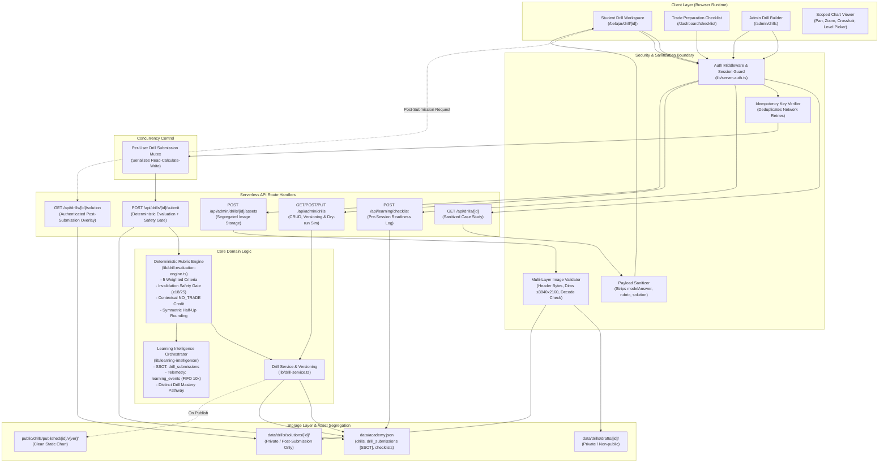
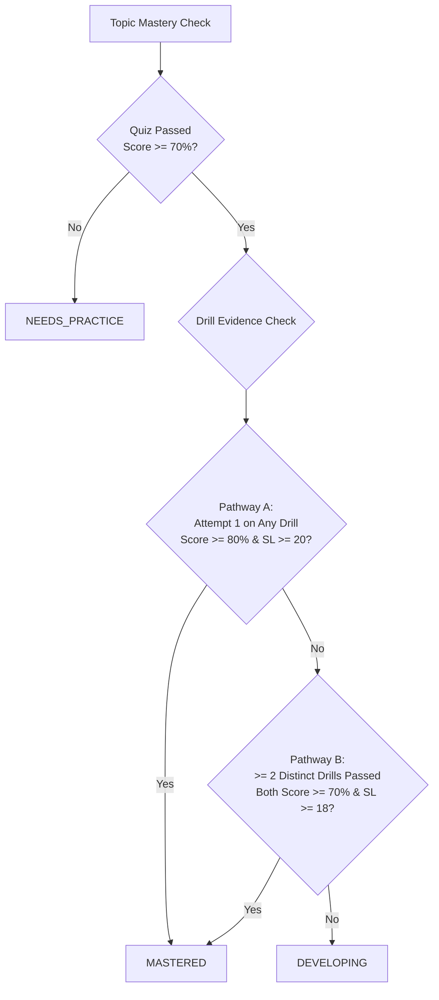

# SIGNAL CASPER ACADEMY — SPRINT 5
# SYSTEM ARCHITECTURE & INTEGRATION SPECIFICATION — REVISION 3

**Title:** Practical Learning & Interactive Drill Engine Architecture  
**Sprint:** Sprint 5  
**Document Version:** 3.0.0  
**Status:** PLANNING ONLY — REVISED POST PRODUCT OWNER CONSISTENCY REVIEW (REV 3)  
**Baseline:** Sprint 1–4 Accepted & Frozen  
**Date:** November 12, 2026  

---

## 1. HIGH-LEVEL ARCHITECTURAL OVERVIEW

The Practical Drill Engine bridges theoretical curriculum (Sprint 2) with practical evaluation and adaptive intelligence (Sprint 4). It is architected with strict domain boundaries, segregating learning simulations from the private trading journal (Sprint 3) and enforcing server-side safety gates and concurrency serialization.



---

## 2. CONCURRENCY SERIALIZATION & IDEMPOTENCY ARCHITECTURE

In a single-file JSON database (`data/academy.json`), concurrent client requests risk race conditions during read-modify-write cycles and duplicate attempt increments.

### 2.1 Per-User Drill Mutex Pattern
All submissions for a given `(userId, drillId)` tuple are routed through an in-memory queue:

```typescript
// Concurrency mutex per user and drill
const submissionMutexMap = new Map<string, Promise<void>>();

export async function withSubmissionLock<T>(
  userId: string,
  drillId: string,
  operation: () => Promise<T>
): Promise<T> {
  const lockKey = `${userId}::${drillId}`;
  const previousLock = submissionMutexMap.get(lockKey) || Promise.resolve();

  let releaseLock: () => void;
  const currentLock = new Promise<void>((resolve) => {
    releaseLock = resolve;
  });

  submissionMutexMap.set(lockKey, currentLock);

  try {
    await previousLock;
    return await operation();
  } finally {
    releaseLock!();
    if (submissionMutexMap.get(lockKey) === currentLock) {
      submissionMutexMap.delete(lockKey);
    }
  }
}
```

### 2.2 Atomic Attempt Numbering
Within the mutex lock:
1. Load latest database state from disk/cache.
2. Filter `drill_submissions` for `userId` and `drillId`.
3. Compute `nextAttemptNumber = existingAttempts.length + 1`.
4. Run deterministic evaluation and compute scores.
5. Create immutable submission record with `attempt_number: nextAttemptNumber`.
6. Atomic write to disk using `writeAtomicFileWithBackup`.

### 2.3 Idempotency Key Handling
1. Client generates a unique UUID `Idempotency-Key: <uuid>` on submission.
2. The server checks if `idempotency_key` exists in recent submissions (within 24 hours).
3. **If duplicate detected**: Server returns the exact cached evaluation payload with HTTP `200 OK` and header `X-Cache-Lookup: HIT-IDEMPOTENT`, without incrementing `attempt_number` or appending duplicate records.
4. **If new key**: Evaluates normally and saves `idempotency_key` with the submission record.

---

## 3. ASSET STORAGE SEGREGATION & MULTI-LAYER IMAGE VALIDATION

```
data/
 ├── academy.json                          <-- DB SSOT
 └── drills/
      ├── drafts/                          <-- PRIVATE (Admin Only)
      │    └── [drill-id]/
      │         └── case_v1.webp
      └── solutions/                       <-- PRIVATE (Authenticated Post-Submission Only)
           └── [drill-id]/
                └── solution_v1.webp

public/
 └── drills/
      └── published/                       <-- STATIC PUBLIC (Clean Chart Only)
           └── [drill-id]/
                └── v1/
                     └── case.webp         <-- No annotations, no answer keys
```

### 3.1 Multi-Layer Image Validation Pipeline
1. **Format Whitelist**: Only `.png` and `.webp` are accepted. SVG is rejected immediately.
2. **Magic Bytes Inspection**:
   - PNG: `89 50 4E 47 0D 0A 1A 0A`
   - WebP: `52 49 46 46` ... `57 45 42 50`
3. **Structural Chunk & Dimension Parsing**:
   - Parses the IHDR chunk for PNG or VP8/VP8L/VP8X header for WebP to read width and height.
   - Rejects images exceeding $3840\text{px}$ width or $2160\text{px}$ height.
   - Rejects images exceeding $8,294,400$ total pixels (prevents decompression bomb attacks).
   - Rejects files larger than $2.5\text{MB}$.
4. **Server-Generated Filenames**:
   Files are written to disk using UUIDs generated on the server (`crypto.randomUUID() + ".webp"`). No user-supplied filenames or paths are ever used on disk.

---

## 4. DISTINCT DRILL MASTERY EVIDENCE MODEL

In Sprint 4, topic mastery was computed from MCQ quizzes. In Sprint 5, practical mastery is evaluated with strict multi-evidence rules:



### Strict Mastery Rules:
1. **Distinct Drill IDs Required**: Repeating the same `drill_id` 10 times and passing twice produces only **one** source of evidence. It cannot fulfill Pathway B.
2. **Safety Gate Mandatory**: A drill passed with 75% total but $< 18/25$ on Invalidation fails the safety gate and cannot be used as mastery evidence.
3. **Drill Version Locking**: A student who earned mastery on Version 1 retains their historical mastery status even if the instructor publishes Version 2, unless the course undergoes an administrative syllabus deprecation audit.

---

## 5. CONTEXTUAL NO-TRADE EVALUATION IN ARCHITECTURE

```
[ Student selects NO_TRADE Stance ]
                  │
                  ▼
┌────────────────────────────────────────────────────────┐
│ EVALUATION ENGINE (lib/drill-evaluation-engine.ts)     │
│                                                        │
│ 1. Check if modelAnswer.isNoTradeValid === true       │
│    ├── If YES:                                         │
│    │     CRIT_BIAS: Graded on macro direction (20 Pts) │
│    │     CRIT_ENTRY: Full Credit (25 Pts) - Withheld   │
│    │     CRIT_INVALID: Full Credit (25 Pts) - Safety   │
│    │     CRIT_RR: Full Credit (15 Pts) - Capital Saved │
│    │     CRIT_CONFIRM: Evaluated on No-Trade Reason   │
│    │     SAFETY GATE: MET (25 >= 18)                   │
│    │                                                   │
│    └── If NO (Forced No-Trade on high-prob setup):     │
│          CRIT_ENTRY: 0 Pts (Missed execution)          │
│          CRIT_INVALID: 0 Pts (Unjustified inaction)    │
│          SAFETY GATE: FAILED (0 < 18)                  │
└────────────────────────────────────────────────────────┘
```
In `NO_TRADE` mode, the safety gate evaluates **capital preservation discipline** rather than a numerical stop-loss price, allowing disciplined students to achieve 100/100 without opening phantom trades.
