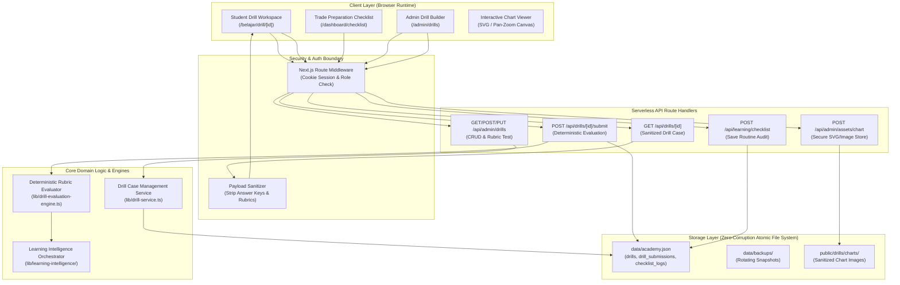
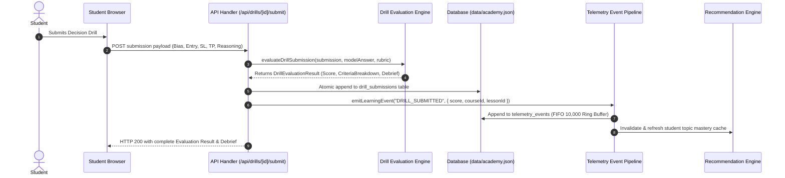

# SIGNAL CASPER ACADEMY — SPRINT 5
# SYSTEM ARCHITECTURE & INTEGRATION SPECIFICATION

**Title:** Practical Learning & Interactive Drill Engine Architecture  
**Sprint:** Sprint 5  
**Document Version:** 1.0.0  
**Status:** PLANNING ONLY — NO IMPLEMENTATION  
**Date:** November 10, 2026  

---

## 1. HIGH-LEVEL ARCHITECTURAL OVERVIEW

The Practical Drill Engine is architected as an educational simulation layer that bridges the **Course Curriculum (Sprint 2)** and the **Learning Intelligence Engine (Sprint 4)**. It operates in strict isolation from the **Student Trading Journal (Sprint 3)** to maintain clear domain boundaries and prevent data contamination.



---

## 2. COMPONENT DECOMPOSITION

### 2.1 Client Components (Frontend)
1. **`InteractiveChartViewer.tsx`**:
   - Zero-dependency interactive viewer supporting pan, zoom, coordinate crosshair, and structural price level overlay.
   - Built with pure SVG/Canvas and CSS transform matrix (`touch-action: none; cursor: crosshair;`).
   - Renders baseline clean chart during the drill; renders comparison solution overlay after submission.
2. **`StudentDrillWorkspace.tsx`**:
   - Manages drill state: problem context, prompt questions, interactive input fields (Bias selector, Entry price, Invalidation price, Target price, R:R live calculator, Setup confirmation badges, and Trade Rationale textarea).
   - Handles `NO_TRADE` mode toggle: gracefully collapses Entry/SL/TP fields and presents structured invalidation rationale questions.
3. **`DrillEvaluationDebrief.tsx`**:
   - Displays evaluation results: overall percentage score, earned badges, criterion-by-criterion rubric scoring breakdown, and instructor debrief text.
4. **`TradePrepChecklistWorkspace.tsx`**:
   - 5-pillar questionnaire assessing psychological calm, risk management boundaries, and market calendar awareness. Generates immediate readiness diagnosis.
5. **`AdminDrillBuilderWorkspace.tsx`**:
   - Admin GUI for drafting drills, uploading chart assets, setting price tolerances, configuring scoring rubrics, and executing mock evaluations.

### 2.2 Server Services & Route Handlers (Backend)
1. **`lib/drill-evaluation-engine.ts`**:
   - Pure, deterministic evaluation functions.
   - Takes `studentSubmission` and `drillModelAnswer` with `rubricRules`, computing the score per criterion with explicit tolerance checking.
   - Generates contextual explanation strings explaining the gap between submitted values and institutional standards.
2. **`lib/drill-service.ts`**:
   - Handles drill CRUD, retrieval, and payload sanitization.
   - Functions: `getPublishedDrillForStudent(id)`, `getAllDrillsForAdmin()`, `saveDrillCase(caseData, adminId)`, `recordDrillSubmission(subData)`.
3. **`lib/checklist-service.ts`**:
   - Validates and stores pre-session checklists in `data/academy.json`.

---

## 3. INTEGRATION WITH LEARNING INTELLIGENCE (SPRINT 4)

To uphold the Single Source of Truth (SSOT) principle and prevent architectural fragmentation, the Practical Drill Engine connects to Sprint 4 through standardized telemetry and normalization hooks:



### 3.1 Telemetry Event Expansion
In `lib/db.ts`, `LearningEventType` is extended cleanly:
```typescript
export type LearningEventType =
  | "COURSE_STARTED"
  | "LESSON_STARTED"
  | "LESSON_COMPLETED"
  | "QUIZ_SUBMITTED"
  | "COURSE_COMPLETED"
  | "DRILL_SUBMITTED"; // New Sprint 5 event
```

### 3.2 Topic Mastery Formula Enrichment
In Sprint 4, topic mastery was computed solely from lesson completion and quiz scores. In Sprint 5, topic mastery incorporates practical competency:
* **`NEEDS_PRACTICE`**: Drill attempted with score $< 70\%$ OR quiz failed.
* **`DEVELOPING`**: Quiz passed ($\ge 70\%$), but drill not yet completed.
* **`MASTERED`**: Both quiz passed ($\ge 70\%$) AND drill passed ($\ge 70\%$) on the corresponding module topic.

### 3.3 Recommendation Engine Expansion
New recommendation triggers are added to `lib/learning-intelligence/recommendation-engine.ts`:
* **`PRACTICE_DRILL` (Priority 88)**: Triggered when a student completes all theoretical lessons in a module and has a practical drill waiting.
* **`RETRY_DRILL` (Priority 94)**: Triggered when a student fails a practical drill ($< 70\%$), providing a direct CTA to review the case or re-attempt.

---

## 4. SECURITY BOUNDARIES & DATA SANITIZATION

```
[ UNTRUSTED CLIENT ]
        │
        ▼ (GET /api/drills/case-xauusd-01)
┌────────────────────────────────────────────────────────┐
│ API ROUTE: app/api/drills/[id]/route.ts                │
│                                                        │
│ 1. Validate JWT session token (Student)                │
│ 2. Fetch full drill record from storage                │
│ 3. Execute sanitizeDrillForStudent(record)             │
│    ├── RETAINS: id, title, prompt, instrument, chart   │
│    └── STRIPS: modelAnswer, rubric, solutionOverlay,   │
│                instructorDebrief, evaluationWeights    │
└────────────────────────────────────────────────────────┘
        │
        ▼ (Returns Sanitized JSON)
[ STUDENT BROWSER ] ── Zero Answer Key Leakage
```

### 4.1 Strict Sanitization Contract
The server enforces a strict TypeScript transformation `sanitizeDrillForStudent(drill: DbDrillCase): PublicDrillCase` before any data reaches the wire. No client-side hiding, no HTML comment tricks, and no hidden DOM elements.

---

## 5. FILE STORAGE & CHART ASSET MANAGEMENT

1. **Asset Directory**: Chart images reside in `public/drills/charts/[drill-id]/`.
2. **File Format Constraints**:
   - Formats allowed: `.png`, `.webp`, `.svg`.
   - Max file size: $2.5\text{ MB}$ per image.
   - SVG sanitization: SVGs uploaded via admin must be stripped of any `<script>`, `onload`, or foreign object attributes to eliminate Stored XSS vectors.
3. **No External CDN or S3 Required**: Assets are served statically through Next.js built-in static asset serving, adhering strictly to the zero-external-dependency rule.

