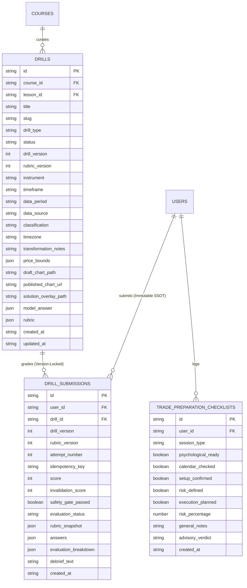

# SIGNAL CASPER ACADEMY — SPRINT 5
# DATA MODEL & SCHEMA SPECIFICATION — REVISION 3

**Title:** Practical Drill & Trade Preparation Data Model  
**Sprint:** Sprint 5  
**Document Version:** 3.0.0  
**Status:** PLANNING ONLY — REVISED POST PRODUCT OWNER CONSISTENCY REVIEW (REV 3)  
**Baseline:** Sprint 1–4 Accepted & Frozen  
**Date:** November 12, 2026  

---

## 1. SCHEMA SEPARATION: IMMUTABLE HISTORY VS DERIVED PROGRESS

A critical architectural requirement established in the Final Architecture Review is the **complete separation between raw immutable attempt history and derived student progress summaries**.

1. **`drill_submissions` (Immutable SSOT)**: Every submission represents a permanent, historical event that is never mutated, updated, or recalculated.
2. **`StudentDrillSummary` (Derived Projection)**: Computed dynamically on request from the submission history (or cached in memory).



---

## 2. TYPE DEFINITIONS & SCHEMAS

### 2.1 Collection: `drills`

```typescript
export type DrillType = 
  | "DIRECTION_BIAS"        // High timeframe order flow & bias analysis
  | "LEVEL_IDENTIFICATION"   // Key zone & liquidity pool identification
  | "SETUP_EXECUTION"       // Complete entry, invalidation, target & confirmation
  | "INVALIDATION_RISK";    // Invalidation placement & R:R feasibility analysis

export type DrillPublicationStatus = "DRAFT" | "PUBLISHED" | "ARCHIVED";

export interface ChartPriceBounds {
  minPrice: number; // Lowest price visible on chart Y-axis
  maxPrice: number; // Highest price visible on chart Y-axis
  decimals: number; // e.g. 2 for Gold (XAUUSD), 0 for JPY
}

export interface DrillModelAnswer {
  expectedBias: "BULLISH" | "BEARISH" | "SIDEWAYS_NEUTRAL";
  isNoTradeValid: boolean;
  validNoTradeReasons?: string[]; // e.g. ["LOW_RISK_REWARD", "MAJOR_NEWS_IMMINENT", "CHOPPY_RANGE"]
  
  // Numerical Zones
  entryZone: {
    min: number;
    max: number;
    ideal: number;
    tolerance: number; // e.g. ±1.50
  };
  invalidationPrice: {
    ideal: number;
    tolerance: number; // e.g. ±0.80
  };
  targetPrice: {
    ideal: number;
    tolerance: number; // e.g. ±2.50
  };
  minimumRiskRewardRatio: number; // e.g. 2.0 (1:2)
  
  // Structural confirmations & keywords
  requiredConfirmations: string[];
  validRationaleKeywords: string[];
}

export interface DrillRubricCriterion {
  id: "CRIT_BIAS" | "CRIT_ENTRY" | "CRIT_INVALID" | "CRIT_RR" | "CRIT_CONFIRM";
  name: string;
  weight: number; // Must sum exactly to 100 (20, 25, 25, 15, 15)
  minimumPassPoints?: number; // 18 for CRIT_INVALID
  description: string;
}

export interface DrillRubric {
  overallPassingScore: number; // 70
  invalidationSafetyGatePoints: number; // 18 out of 25
  criteria: DrillRubricCriterion[];
}

export interface DbDrillCase {
  id: string; // "drill_xauusd_c1_01"
  course_id: string; // "course_xauusd_basic"
  course_slug: string; // "xauusd-basic"
  lesson_id: string; // "c1-market-structure"
  title: string;
  slug: string;
  drill_type: DrillType;
  status: DrillPublicationStatus;
  
  // Versioning Semantics
  drill_version: number; // Increments when model answer or price bounds change
  rubric_version: number; // Increments when weights or criteria change
  
  // Provenance & Transparency
  instrument: string; // "XAUUSD"
  timeframe: string; // "H1"
  data_period: string; // "2024-10-14 08:00 - 16:00 UTC"
  data_source: string; // "Institutional Tick History (Curated)"
  classification: "HISTORICAL_MARKET" | "SYNTHETIC_SIMULATION";
  timezone: string; // "UTC"
  transformation_notes: string; // e.g. "Asian session high highlighted; candle bodies unmodified"
  price_bounds: ChartPriceBounds;
  
  // Segregated Media Storage Paths (PNG & WebP only, zero SVG)
  draft_chart_path: string; // "data/drills/drafts/[id]/case_v1.webp" (Private)
  published_chart_url: string; // "/drills/published/[id]/v1/case.webp" (Public static)
  solution_overlay_path: string; // "data/drills/solutions/[id]/solution_v1.webp" (Private)
  
  // Prompts & Instructions
  context_prompt: string;
  instructions: string[];
  
  // Private Grading Secrets
  model_answer: DrillModelAnswer;
  rubric: DrillRubric;
  instructor_debrief: string;
  
  created_at: string;
  updated_at: string;
}
```

---

### 2.2 Collection: `drill_submissions` (Permanent Immutable SSOT)

```typescript
export interface StudentDrillAnswer {
  bias: "BULLISH" | "BEARISH" | "SIDEWAYS_NEUTRAL";
  isNoTrade: boolean;
  noTradeReason?: string;
  
  entryPrice?: number;
  invalidationPrice?: number;
  targetPrice?: number;
  calculatedRiskReward?: number;
  
  clickedCoordinates?: {
    entry?: { x: number; y: number };
    invalidation?: { x: number; y: number };
    target?: { x: number; y: number };
  };
  
  selectedConfirmations: string[];
  rationaleText: string;
}

export interface CriterionEvaluationResult {
  criterionId: "CRIT_BIAS" | "CRIT_ENTRY" | "CRIT_INVALID" | "CRIT_RR" | "CRIT_CONFIRM";
  criterionName: string;
  pointsPossible: number;
  pointsEarned: number;
  status: "FULL_CREDIT" | "PARTIAL_CREDIT" | "ZERO_CREDIT";
  explanation: string;
}

export interface DbDrillSubmission {
  id: string; // "sub_drill_1731234567_abc123"
  user_id: string;
  drill_id: string;
  drill_version: number; // Locked drill version at evaluation time
  rubric_version: number; // Locked rubric version at evaluation time
  attempt_number: number; // Atomic 1, 2, 3...
  idempotency_key: string; // Client UUID preventing double-submit
  
  score: number; // 0 - 100
  invalidation_score: number; // 0 - 25
  safety_gate_passed: boolean; // true if invalidation_score >= 18
  evaluation_status: "PASSED" | "FAILED_SAFETY_GATE" | "FAILED";
  
  rubric_snapshot: DrillRubric; // Frozen immutable rubric snapshot
  answers: string; // Serialized StudentDrillAnswer
  evaluation_breakdown: string; // Serialized CriterionEvaluationResult[]
  debrief_text: string;
  created_at: string;
}
```

---

### 2.3 Derived Student Progress Summary (Computed from History)

This summary is **never saved as mutating fields inside raw submissions**. It is computed dynamically via `computeStudentDrillSummary(submissions)`:

```typescript
export interface StudentDrillSummary {
  userId: string;
  drillId: string;
  attemptsCount: number;
  firstScore: number;
  firstAttemptPassed: boolean;
  latestScore: number;
  bestScore: number;
  isPassed: boolean;
  safetyGateMet: boolean;
  firstAttemptAt: string;
  lastAttemptAt: string;
}

export function computeStudentDrillSummary(
  userId: string,
  drillId: string,
  submissions: DbDrillSubmission[]
): StudentDrillSummary | null {
  const userSubs = submissions
    .filter((s) => s.user_id === userId && s.drill_id === drillId)
    .sort((a, b) => a.attempt_number - b.attempt_number);

  if (userSubs.length === 0) return null;

  const first = userSubs[0];
  const latest = userSubs[userSubs.length - 1];
  const passedSubs = userSubs.filter((s) => s.evaluation_status === "PASSED");
  const best = userSubs.reduce((max, s) => (s.score > max.score ? s : max), first);

  return {
    userId,
    drillId,
    attemptsCount: userSubs.length,
    firstScore: first.score,
    firstAttemptPassed: first.evaluation_status === "PASSED",
    latestScore: latest.score,
    bestScore: best.score,
    isPassed: passedSubs.length > 0,
    safetyGateMet: userSubs.some((s) => s.safety_gate_passed),
    firstAttemptAt: first.created_at,
    lastAttemptAt: latest.created_at,
  };
}
```

---

### 2.4 Collection: `trade_preparation_checklists`

```typescript
export interface DbTradePreparationChecklist {
  id: string;
  user_id: string;
  session_type: "LONDON_OPEN" | "NEW_YORK_OPEN" | "ASIAN_SESSION" | "SWING_STUDY";
  psychological_ready: boolean;
  calendar_checked: boolean;
  setup_confirmed: boolean;
  risk_defined: boolean;
  execution_planned: boolean;
  risk_percentage: number; // e.g. 1.0%
  general_notes: string;
  advisory_verdict: "OPTIMAL" | "CAUTION_PROCEED_WITH_CARE" | "DO_NOT_TRADE_TODAY";
  created_at: string;
}
```

---

## 3. SAFE BACKWARD-COMPATIBLE MIGRATION

When the application boots, `lib/db.ts` executes `migrateDatabaseSchemaV5` on `loadDatabase()`:
```typescript
export function migrateDatabaseSchemaV5(rawDb: DatabaseSchema): DatabaseSchema {
  const db = { ...rawDb };
  
  if (!Array.isArray(db.drills)) {
    db.drills = [];
  }
  if (!Array.isArray(db.drill_submissions)) {
    db.drill_submissions = [];
  }
  if (!Array.isArray(db.trade_preparation_checklists)) {
    db.trade_preparation_checklists = [];
  }
  
  return db;
}
```
* **Strict Non-Destructive Invariant**: Zero changes made to existing `users`, `course_progress`, `quiz_submissions`, or `learning_events`.
* **Zero Base64 in Database**: Storage holds only clean string metadata and file paths.
