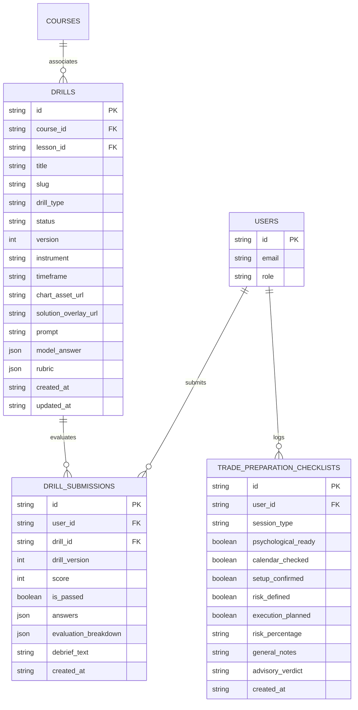

# SIGNAL CASPER ACADEMY — SPRINT 5
# DATA MODEL & SCHEMA SPECIFICATION

**Title:** Practical Drill & Trade Preparation Data Model  
**Sprint:** Sprint 5  
**Document Version:** 1.0.0  
**Status:** PLANNING ONLY — NO IMPLEMENTATION  
**Date:** November 10, 2026  

---

## 1. SCHEMA OVERVIEW & INTEGRATION

The Sprint 5 data model extends `DatabaseSchema` in [`lib/db.ts`](file:///d:/Developer/Web-Edukasi-Casper-main/lib/db.ts) by introducing three new first-class collections:
1. `drills`: Authoritative repository of practical chart drill cases and rubrics.
2. `drill_submissions`: Immutable historical record of student drill evaluations.
3. `trade_preparation_checklists`: Student pre-session readiness logs.

All collections reside within `data/academy.json`, persisted via the proven `writeAtomicFileWithBackup` engine with zero external database dependencies.



---

## 2. TYPE DEFINITIONS & SCHEMAS

### 2.1 Collection: `drills`

```typescript
export type DrillType = 
  | "DIRECTION_BIAS"        // High timeframe order flow & bias analysis
  | "LEVEL_IDENTIFICATION"   // Key zone & liquidity pool identification
  | "SETUP_EXECUTION"       // Complete entry, invalidation, target & confirmation
  | "INVALIDATION_RISK";    // Invalidation placement & R:R feasibility analysis

export type DrillPublicationStatus = "DRAFT" | "PUBLISHED" | "ARCHIVED";

export interface DrillModelAnswer {
  // Market Direction
  expectedBias: "BULLISH" | "BEARISH" | "SIDEWAYS_NEUTRAL";
  isNoTradeValid: boolean;
  
  // Numerical Zones (for Gold / Forex)
  entryZone: {
    min: number;
    max: number;
    ideal: number;
    tolerance: number; // e.g. ±1.50
  };
  invalidationPrice: {
    ideal: number;
    tolerance: number; // e.g. ±1.00
  };
  targetPrice: {
    ideal: number;
    tolerance: number; // e.g. ±2.00
  };
  minimumRiskRewardRatio: number; // e.g. 2.0 (1:2)
  
  // Structural tags & reasoning
  requiredConfirmations: string[]; // e.g. ["LIQUIDITY_SWEEP", "M15_CHOC", "FVG_TAP"]
  validRationaleKeywords: string[]; // e.g. ["discount zone", "equal highs taken", "supply rejection"]
  noTradeReasons?: string[]; // e.g. ["RISK_REWARD_TOO_LOW", "MAJOR_NEWS_IMMINENT"]
}

export interface DrillRubricCriterion {
  id: string;
  name: string;
  weight: number; // e.g. 25 (out of 100)
  description: string;
  evaluationMethod: "EXACT_MATCH" | "NUMERICAL_TOLERANCE" | "KEYWORD_SET" | "LOGICAL_CONDITION";
}

export interface DrillRubric {
  passingScore: number; // Default: 70
  criteria: DrillRubricCriterion[];
}

export interface DbDrillCase {
  id: string; // "drill_xauusd_c1_01"
  course_id: string; // "course_xauusd_basic"
  course_slug: string; // "xauusd-basic"
  lesson_id: string; // "c1-market-structure"
  title: string; // "Studi Kasus 01: Identifikasi Liquidity Sweep H1"
  slug: string; // "xauusd-liquidity-sweep-h1"
  drill_type: DrillType;
  status: DrillPublicationStatus;
  version: number; // Incremented on rubric/model answer update
  
  // Provenance & Market Context
  instrument: string; // "XAUUSD"
  timeframe: string; // "H1"
  data_source: string; // "Historical Gold Futures Data"
  historical_date_range: string; // "2024-10-14 08:00 - 16:00 UTC"
  verification_status: "VERIFIED_BY_ACADEMY_DESK";
  
  // Visual Media
  chart_asset_url: string; // "/drills/charts/drill_xauusd_01/case.webp"
  solution_overlay_url: string; // "/drills/charts/drill_xauusd_01/solution.webp"
  
  // Educational Prompts
  context_prompt: string;
  instructions: string[];
  
  // Server-Private Grading Secrets
  model_answer: DrillModelAnswer;
  rubric: DrillRubric;
  instructor_debrief: string;
  
  created_at: string;
  updated_at: string;
}
```

### 2.2 Collection: `drill_submissions`

```typescript
export interface StudentDrillAnswer {
  bias: "BULLISH" | "BEARISH" | "SIDEWAYS_NEUTRAL";
  isNoTrade: boolean;
  noTradeReason?: string;
  
  entryPrice?: number;
  invalidationPrice?: number;
  targetPrice?: number;
  calculatedRiskReward?: number;
  
  selectedConfirmations: string[];
  rationaleText: string;
}

export interface CriterionEvaluationResult {
  criterionId: string;
  criterionName: string;
  pointsPossible: number;
  pointsEarned: number;
  status: "FULL_CREDIT" | "PARTIAL_CREDIT" | "ZERO_CREDIT";
  explanation: string;
}

export interface DbDrillSubmission {
  id: string; // "sub_drill_1731234567_abc123"
  user_id: string;
  drill_id: string;
  drill_version: number;
  score: number; // 0 - 100
  is_passed: boolean;
  answers: string; // Serialized StudentDrillAnswer
  evaluation_breakdown: string; // Serialized CriterionEvaluationResult[]
  debrief_text: string;
  created_at: string;
}
```

### 2.3 Collection: `trade_preparation_checklists`

```typescript
export interface DbTradePreparationChecklist {
  id: string;
  user_id: string;
  session_type: "LONDON_OPEN" | "NEW_YORK_OPEN" | "ASIAN_SESSION" | "SWING_STUDY";
  psychological_ready: boolean;
  calendar_checked: boolean;
  setup_confirmed: boolean;
  risk_defined: boolean;
  execution_planned: boolean;
  risk_percentage: number; // e.g. 1.0%
  general_notes: string;
  advisory_verdict: "OPTIMAL" | "CAUTION_PROCEED_WITH_CARE" | "DO_NOT_TRADE_TODAY";
  created_at: string;
}
```

---

## 3. SAFE MIGRATION & BACKWARD COMPATIBILITY

To ensure existing data in `data/academy.json` is preserved without mutation errors:

```typescript
export function migrateDatabaseSchemaV5(rawDb: DatabaseSchema): DatabaseSchema {
  const db = { ...rawDb };
  
  // Backward-compatible collection initializers
  if (!Array.isArray(db.drills)) {
    db.drills = [];
  }
  if (!Array.isArray(db.drill_submissions)) {
    db.drill_submissions = [];
  }
  if (!Array.isArray(db.trade_preparation_checklists)) {
    db.trade_preparation_checklists = [];
  }
  
  return db;
}
```

* **Zero-Touch on Existing Tables**: `users`, `course_progress`, `quiz_submissions`, `learning_events`, and `admin_audit_logs` are left untouched.
* **Preservation**: The atomic migration function executes transparently during initial load if keys are absent, guaranteeing 100% backward compatibility.

