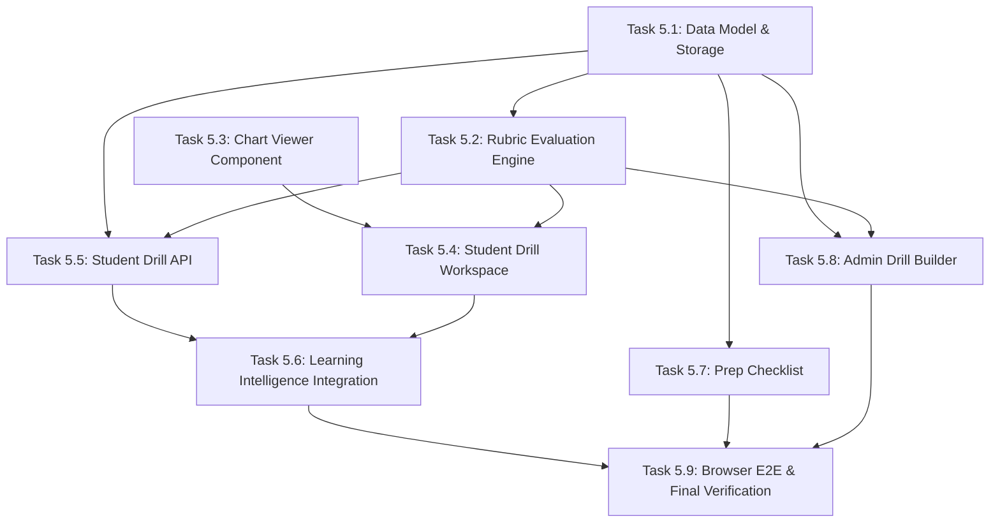

# SIGNAL CASPER ACADEMY — SPRINT 5
# IMPLEMENTATION PLAN & WORK BREAKDOWN STRUCTURE (WBS)

**Title:** Practical Learning & Interactive Drill Engine Implementation Plan  
**Sprint:** Sprint 5  
**Document Version:** 1.0.0  
**Status:** PLANNING ONLY — NO IMPLEMENTATION  
**Date:** November 10, 2026  

---

## 1. TASK BREAKDOWN & COMPLEXITY ESTIMATES

Relative complexity is estimated using standard Fibonacci Story Points ($1, 2, 3, 5, 8, 13$).

| Task ID | Task Title & Deliverables | Priority | Complexity (SP) | Prerequisite Tasks |
| :--- | :--- | :--- | :--- | :--- |
| **TASK 5.1** | **Data Model & Atomic Storage Extension** - Extend `DatabaseSchema` with `drills`, `drill_submissions`, `trade_preparation_checklists` - Implement backward-compatible migration & getter/setter in `lib/db.ts` | **P0** | **3 SP** | *None* |
| **TASK 5.2** | **Deterministic Evaluation Rubric Engine** - Author `lib/drill-evaluation-engine.ts` - Implement tolerance checks, R:R calculation, and `NO_TRADE` scoring logic - Unit tests with synthetic test benchmarks | **P0** | **5 SP** | TASK 5.1 |
| **TASK 5.3** | **Interactive Chart Viewer Component** - Author `components/drills/InteractiveChartViewer.tsx` - Implement zero-dependency pan, zoom, crosshair, and level overlay - Responsive touch gestures with zero document overflow | **P0** | **5 SP** | *None* |
| **TASK 5.4** | **Student Drill Workspace & Execution Console** - Author `app/belajar/drill/[id]/page.tsx` & `components/drills/StudentDrillWorkspace.tsx` - Form inputs, R:R live calculator, setup confirmations, `NO_TRADE` toggle - Evaluation debrief view with criteria breakdown | **P0** | **5 SP** | TASK 5.2, TASK 5.3 |
| **TASK 5.5** | **Student Drill API Route Handlers** - Author `app/api/drills/[id]/route.ts` & `submit/route.ts` - Integrate sanitization (zero answer leak) & rate limiting | **P0** | **3 SP** | TASK 5.1, TASK 5.2 |
| **TASK 5.6** | **Learning Intelligence & Telemetry Integration** - Extend `LearningEventType` with `DRILL_SUBMITTED` - Update topic mastery to evaluate practical competency - Add `PRACTICE_DRILL` & `RETRY_DRILL` recommendations | **P1** | **5 SP** | TASK 5.1, TASK 5.5 |
| **TASK 5.7** | **Trade Preparation Checklist Feature** - Author `components/checklist/TradePrepChecklistWorkspace.tsx` - Author `app/api/learning/checklist/route.ts` - Pre-session advisory logic and student history view | **P1** | **3 SP** | TASK 5.1 |
| **TASK 5.8** | **Admin Drill Builder Workspace & API** - Author `app/admin/drills/page.tsx` & `AdminDrillBuilderWorkspace.tsx` - Form for case drafting, chart asset upload, rubric setup, and dry-run test tool | **P2** | **8 SP** | TASK 5.1, TASK 5.2 |
| **TASK 5.9** | **Real Browser Playwright E2E & Full Verification** - End-to-end browser tests for drill submission, no-trade decision, checklist, and admin builder - 4 viewport responsive verification (1440, 768, 390, 360) - Production build & hash checks | **P0** | **5 SP** | All Tasks |
| **TOTAL** | **9 Cohesive Engineering Tasks** | | **42 SP** | |

---

## 2. DEPENDENCY GRAPH

---

## 3. IMPLEMENTATION PHASES

### Phase 1: Core Foundation & Evaluation Engine (Tasks 5.1, 5.2, 5.3)
- Focus on mathematical accuracy, schema durability, and responsive chart viewing.
- Validate with unit tests on synthetic price action benchmarks.

### Phase 2: Student Experience & API Security (Tasks 5.4, 5.5)
- Wire up interactive student console with real-time R:R display and strict server-side evaluation.
- Verify zero answer key leakage in network traffic.

### Phase 3: Adaptive Ecosystem Integration & Readiness (Tasks 5.6, 5.7)
- Connect drill submissions to Learning Intelligence topic mastery and recommendation cards.
- Deploy the Pre-Session Trade Preparation Checklist.

### Phase 4: Administrative Management & Final Quality Gates (Tasks 5.8, 5.9)
- Build the Admin Drill Builder with simulation dry-run capability.
- Execute full 100% test suite, real Chrome browser E2E, and zero-overflow viewport verification.

---

## 4. DEFINITION OF DONE (DOD) FOR SPRINT 5

1. **Functional Completeness**:
   - Students can analyze chart cases, enter trade parameters or select `NO_TRADE`, and receive granular rubric scoring.
   - Pre-session checklist provides clear educational readiness advisories without modifying journals.
   - Admin can author, preview, simulate, and publish drills.
2. **Quality & Test Gates**:
   - 100% automated test pass rate across unit, contract, and E2E suites.
   - Real Chrome browser E2E testing student drill flow and admin builder.
   - TypeScript: 0 errors (`npx tsc --noEmit`).
   - ESLint: 0 errors (`npm run lint`).
   - Next.js production build succeeds cleanly.
3. **Security & Privacy**:
   - Zero answer leakage before submission.
   - Admin audit logs record all drill modifications.
   - Production database hash verified identical prior to any test runs.

