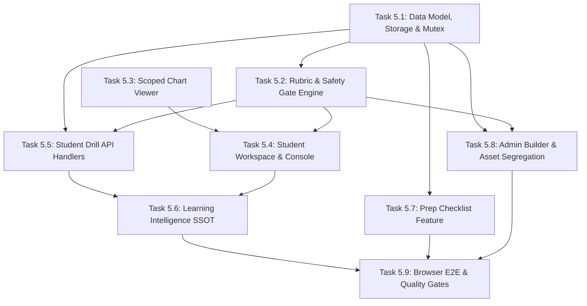

# SIGNAL CASPER ACADEMY — SPRINT 5
# IMPLEMENTATION PLAN & WORK BREAKDOWN STRUCTURE (WBS) — REVISION 3

**Title:** Practical Learning & Interactive Drill Engine Implementation Plan  
**Sprint:** Sprint 5  
**Document Version:** 3.0.0  
**Status:** PLANNING ONLY — REVISED POST PRODUCT OWNER CONSISTENCY REVIEW (REV 3)  
**Baseline:** Sprint 1–4 Accepted & Frozen  
**Date:** November 12, 2026  

---

## 1. REVISED TASK BREAKDOWN & COMPLEXITY ESTIMATES

Estimates are calibrated using Fibonacci Story Points ($1, 2, 3, 5, 8, 13$).

| Task ID | Task Title & Scope | Priority | Complexity (SP) | Prerequisite Tasks |
| :--- | :--- | :--- | :--- | :--- |
| **TASK 5.1** | **Data Model, Atomic Storage & Concurrency Mutex** - Extend `DatabaseSchema` with `drills`, `drill_submissions`, `trade_preparation_checklists` - Implement `withSubmissionLock` per-user mutex and atomic attempt counter - Implement backward-compatible migration & getter in `lib/db.ts` | **P0** | **4 SP** | *None* |
| **TASK 5.2** | **Deterministic Evaluation Rubric, Safety Gate & NO-TRADE Engine** - Author `lib/drill-evaluation-engine.ts` - Implement 5-criterion grading with continuous boundary tolerances - Enforce mandatory Invalidation Safety Gate ($\ge 18/25$) - Implement contextual `NO_TRADE` scoring and symmetric half-up rounding - Unit tests with synthetic test benchmarks | **P0** | **5 SP** | TASK 5.1 |
| **TASK 5.3** | **Scoped Chart Viewer Component (PNG/WebP)** - Author `components/drills/ScopedChartViewer.tsx` - Implement pan, zoom ($1.0\times - 3.0\times$), crosshair, and level placement - Normalized coordinate system ($0.0 - 1.0$) mapped to price bounds - Strictly scoped: no TradingView feature bloat | **P0** | **5 SP** | *None* |
| **TASK 5.4** | **Student Drill Workspace & Decision Console** - Author `components/drills/StudentDrillWorkspace.tsx` & `page.tsx` - Interactive inputs, live R:R calculator, `NO_TRADE` stance switch - Debrief view with Safety Gate banner and attempt history drawer - Unlimited retries without artificial cooldown | **P0** | **5 SP** | TASK 5.2, TASK 5.3 |
| **TASK 5.5** | **Student Drill API Route Handlers with Idempotency** - Author `GET /api/drills/[id]` with strict payload sanitization - Author `POST /api/drills/[id]/submit` (mutex serialized, idempotency key check) - Author `GET /api/drills/[id]/solution` (guarded post-submission stream) - Author `GET /api/drills/[id]/history` (immutable attempt history) | **P0** | **5 SP** | TASK 5.1, TASK 5.2 |
| **TASK 5.6** | **Learning Intelligence SSOT & Distinct Drill Mastery Integration** - Connect `drill_submissions` as permanent SSOT - Emit `DRILL_SUBMITTED` telemetry event to FIFO ring buffer - Implement Distinct Drill Mastery (Pathway A and Pathway B) - Add `PRACTICE_DRILL` & `RETRY_DRILL` recommendations | **P1** | **5 SP** | TASK 5.1, TASK 5.5 |
| **TASK 5.7** | **Trade Preparation Checklist Feature** - Author `components/checklist/TradePrepChecklistWorkspace.tsx` - Author `app/api/learning/checklist/route.ts` - 5-pillar assessment and educational readiness verdict | **P1** | **3 SP** | TASK 5.1 |
| **TASK 5.8** | **Admin Drill Builder, Multi-Layer Image Validator & Asset Segregation** - Author `app/admin/drills/page.tsx` & `AdminDrillBuilderWorkspace.tsx` - Author `lib/image-validator.ts` (enforce PNG/WebP, magic bytes, dimensions $\le 3840\times 2160$) - Implement segregated storage: draft (private), published (public static), solution (private) - Dry-run rubric simulation tool | **P2** | **8 SP** | TASK 5.1, TASK 5.2 |
| **TASK 5.9** | **Real Browser Playwright E2E & Full Quality Verification** - Chrome Playwright E2E tests for student drill, safety gate rejection, retry, checklist, and admin builder - 4-viewport responsive QA (1440, 768, 390, 360) ensuring zero window scroll - Automated concurrent submission & idempotency tests - Full test suite (~285+ PASS across all suites) - TypeScript, ESLint, production build, and database hash checks | **P0** | **5 SP** | All Tasks |
| **TOTAL** | **9 Cohesive Engineering Tasks** | | **45 SP** | |

---

## 2. REVISED DEPENDENCY GRAPH

---

## 3. DEFINITION OF DONE (DOD) FOR SPRINT 5

1. **Safety Gate & Evaluation**:
   - Submissions meeting $\ge 70\%$ overall but $< 18/25$ on Invalidation/Stop-Loss are strictly flagged `FAILED_SAFETY_GATE`.
   - Valid `NO_TRADE` submissions receive full credit on execution criteria without requiring Stop-Loss.
2. **Distinct Drill Mastery**:
   - Topic mastery requires distinct drills for Pathway B. Repeating the same drill does not double-count as mastery evidence.
3. **Attempt History & Retries**:
   - Students can retry immediately with zero cooldown.
   - Raw submissions in `drill_submissions` are immutable and version-locked.
   - Derived summary is computed dynamically.
4. **Concurrency & Idempotency**:
   - Per-user submission mutex serializes rapid requests.
   - Idempotency key returns identical cached result without duplicate records.
5. **Asset Security**:
   - PNG and WebP accepted; SVG rejected by default.
   - Magic bytes and dimensions verified server-side.
   - Drafts and solutions stored in private non-public directories.
6. **Quality & Build Gates**:
   - 100% automated test pass rate.
   - Real Chrome browser E2E test verifying student and admin flows.
   - TypeScript: 0 errors (`npx tsc --noEmit`).
   - ESLint: 0 errors (`npm run lint`).
   - Next.js production build succeeds cleanly.
   - Zero horizontal overflow on mobile viewports (390px and 360px).
