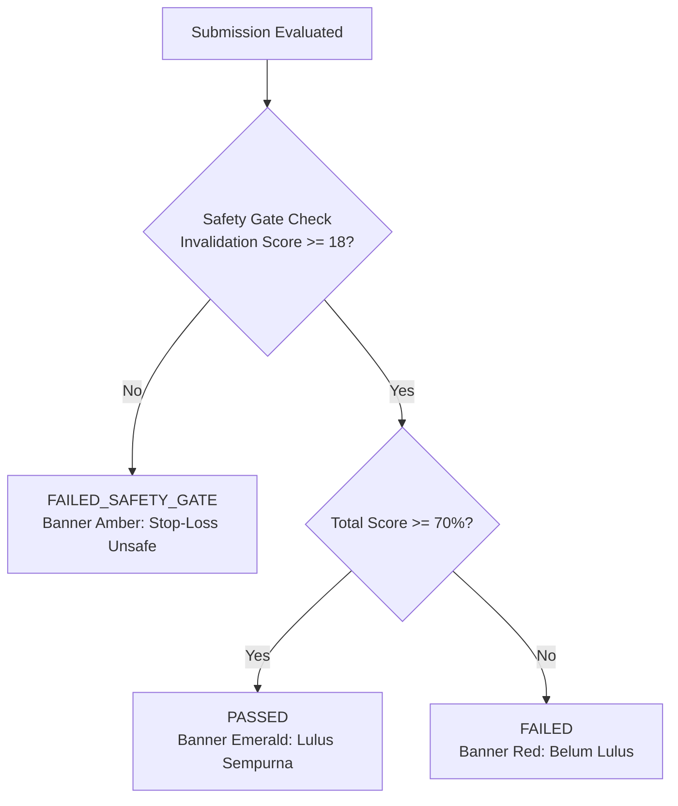

# SIGNAL CASPER ACADEMY — SPRINT 5
# UI/UX & INTERACTION SPECIFICATION — REVISION 3

**Title:** Practical Drill & Pre-Session Checklist User Experience  
**Sprint:** Sprint 5  
**Document Version:** 3.0.0  
**Status:** PLANNING ONLY — REVISED POST PRODUCT OWNER CONSISTENCY REVIEW (REV 3)  
**Baseline:** Sprint 1–4 Accepted & Frozen  
**Date:** November 12, 2026  

---

## 1. DESIGN PHILOSOPHY & SCOPE BOUNDARIES

The UI/UX of the Practical Drill Engine is purposefully scoped to maximize pedagogical feedback without introducing the overhead of a full charting terminal like TradingView.

### Visual Aesthetic (Casper Dark Editorial)
- **Base Canvas**: Deep Slate (`#0b0f17`, `#111827`)
- **Containers**: Solid Dark Panel (`#161e2e`, border `#1f293d`)
- **Cyan Accent**: `#41d9ef` (Active crosshairs, primary focus, interactive level picks)
- **Safety Gate / Risk Amber**: `#f59e0b` (Alerts for safety gate violations)
- **Passed Emerald**: `#53d9bf` (Validated setups and passing milestones)
- **Invalidation Rose**: `#f43f5e` (Stop-loss levels and broken structure)

---

## 2. SCOPED CHART VIEWER INTERACTION

```
┌─────────────────────────────────────────────────────────────┐
│ [XAUUSD · H1 · Provenance Verified]       [Zoom: (-) (+) (R)]│
├─────────────────────────────────────────────────────────────┤
│                                                [ $2,675.00] │
│                                                             │
│       [ CLEAN HISTORICAL CHART IMAGE (PNG/WebP) ]           │
│                                                             │
│  - Pan: Drag with mouse / one-finger swipe                  │
│  - Zoom: Scroll wheel / buttons (1.0x to 3.0x)              │
│  - Crosshair: Coordinate tracking + Floating Price Pill     │
│  - Click-to-Place: Sets Entry / SL / TP with visual lines   │
│                                                             │
│                                                [ $2,645.00] │
└─────────────────────────────────────────────────────────────┘
```

### 2.1 Interaction Rules:
1. **Pan & Drag**: Enabled through standard pointer events (`PointerDown`, `PointerMove`, `PointerUp`) with CSS `touch-action: none; cursor: crosshair;`.
2. **Zoom Range**: Clamped strictly between $1.0\times$ (fit container) and $3.0\times$. Zoom anchor centers on cursor position or explicit zoom controls (`+`, `-`, `Reset`).
3. **Crosshair & Price Readout**: As the user moves across the chart, horizontal and vertical dashed cyan guide lines follow the pointer, and a price pill displays the interpolated price based on Y-axis normalization.
4. **Interactive Level Placement**: Clicking with "Set Entry" active places a cyan dashed line; "Set Stop-Loss" places a rose dashed line; "Set Target" places an emerald dashed line. Coordinates automatically populate the input fields in the right-hand console.

---

## 3. DECISION CONSOLE & SUBMISSION FLOW

### 3.1 Two-Stance Selection
The top of the decision console offers an explicit toggle:
* `[ AMBIL POSISI / TAKE TRADE ]`: Activates Entry, SL, TP, R:R calculation, and Confirmation checklist.
* `[ DISIPLIN NO-TRADE ]`:
  - Instantly collapses price input fields (no Stop-Loss required).
  - Expands structured contextual reasons:
    - `[ ]` Rasio Risk/Reward tidak memadai (< 1:2)
    - `[ ]` Likuiditas utama belum diambil (Likuiditas belum tersapu)
    - `[ ]` Mendekati rilis berita ekonomi berdampak tinggi (FOMC/CPI/NFP)
    - `[ ]` Market berada di tengah range konsolidasi tanpa arah jelas
  - Requires the student to write a brief thesis defending their decision to remain on the sidelines.

---

## 4. EVALUATION DEBRIEF & SAFETY GATE STATES

Upon submission, the console displays one of three clear states:



### 4.1 State Banners:
1. **`PASSED` (Emerald)**:
   - *"Selamat! Evaluasi Praktik LULUS (Skor: 92%, Stop-Loss: 22/25)"*
   - Shows badge: `SAFETY CRITERIA MET`.
2. **`FAILED_SAFETY_GATE` (Amber / Warning)**:
   - *"Belum Lulus — Nilai Total 76%, Namun Manajemen Risiko Tidak Memenuhi Standar Keselamatan"*
   - Explanatory callout: *"Nilai Invalidation/Stop-Loss Anda adalah 12/25 (Syarat minimal: 18/25). Posisi dengan stop-loss terlalu ketat atau tidak berlandaskan struktur dianggap berisiko tinggi dalam trading nyata."*
3. **`FAILED` (Rose / Red)**:
   - *"Belum Lulus — Skor Total 54% (Target: ≥ 70%)"*

### 4.2 Debrief Drawer & Solution Toggle
- **Criterion Breakdown**: Collapsible cards for all 5 criteria with points earned and detailed feedback.
- **Solution Overlay**: A secure toggle button `"Lihat Solusi Institusional"` loads the instructor's annotated chart overlay via `/api/drills/[id]/solution`.
- **Immediate Re-Attempt**: A `"Coba Lagi Studi Kasus"` button allows instant retry without waiting timers.
- **Attempt History Drawer**: Displays derived progress summary (`firstScore`, `bestScore`, `latestScore`, `attemptsCount`) and lists all prior attempts.

---

## 5. RESPONSIVE CONTAINMENT MATRIX

| Viewport | Width | Layout | Chart Containment |
| :--- | :--- | :--- | :--- |
| **Desktop Ultra** | $1440\text{px}$ | 2 Columns ($60\%$ Chart, $40\%$ Console) | Fixed aspect ratio, pan-zoom active |
| **Tablet** | $768\text{px}$ | Stacked Vertical | Chart height $420\text{px}$, touch drag active |
| **Mobile Standard** | $390\text{px}$ | Stacked Single Column | Pinch-zoom, full width, sticky submit CTA |
| **Mobile Compact** | $360\text{px}$ | Stacked Single Column | Chart height $300\text{px}$, `overflow-x: hidden` |

*Guaranteed Rule*: All chart canvases and containers enforce `max-width: 100%; overflow: hidden;` preventing any horizontal page scroll on mobile devices.
